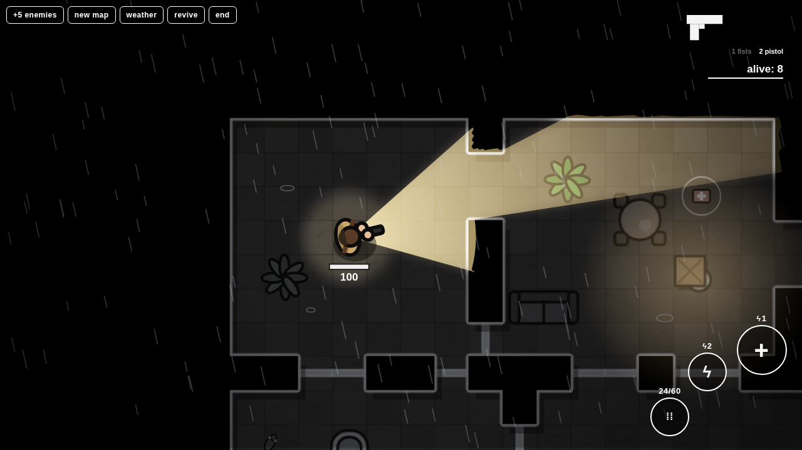

# taser

A top-down tactical shooter in a single offline HTML file (Canvas 2D). Procedural maps, rule-based enemies, missions, hostages, day/night and power cuts.

Play: https://lollo259.github.io/taser/

- desktop: WASD move, mouse aim/fire, 1-9 weapons, E interact, Q taser, H heal
- phone: landscape, twin joysticks

